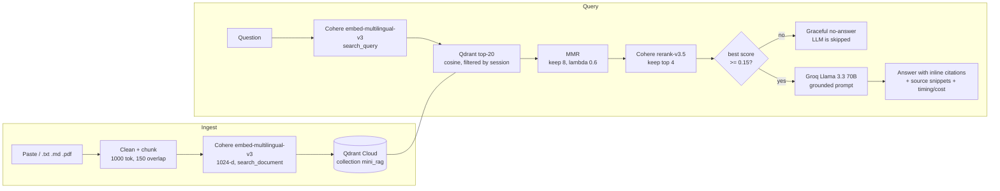

# Mini RAG

A small, production-minded Retrieval-Augmented Generation app. Users paste text or upload a file; it is chunked, embedded and stored in a **cloud-hosted vector database**. Questions go through **retrieval → MMR → reranking → LLM**, and answers show **inline citations** that map to the source passages below them, plus request timing and a rough token/cost estimate.

- **Live URL:** `<paste your deployed URL here>`
- **Resume:** `<paste your resume link here>`
- **Track:** B (retrieval + rerank)

## Architecture



Everything runs in one FastAPI service that also serves the static frontend, so there is a single URL to deploy. API keys live only on the server.

## Providers

| Role | Provider / model | Why |
|---|---|---|
| Vector DB (hosted) | Qdrant Cloud (free tier) | Generous free cluster, payload filtering, simple Python client |
| Embeddings | Cohere `embed-multilingual-v3.0`, 1024 dims | Separate document/query modes; the same free trial key also covers the reranker |
| Reranker | Cohere `rerank-v3.5` | Hosted, so no model weights to ship on a free host |
| LLM | Groq `openai/gpt-oss-120b` | Fast and free tier available |
| Hosting | Render free web service | Deploys straight from GitHub via `render.yaml` |

All model names are env-overridable (see `app/config.py`). Jina is supported as an alternative: set `EMBED_PROVIDER=jina` and `JINA_API_KEY`.

## Vector DB schema and index config

| Item | Value |
|---|---|
| Collection | `mini_rag` (created automatically on startup) |
| Vector | single dense vector, size **1024**, distance **Cosine** |
| Point ID | `uuid5(session:source:position)`, so re-ingesting a document overwrites rather than duplicates |
| Payload | `text`, `source`, `title`, `section`, `position`, `tokens`, `namespace` |
| Payload indexes | keyword on `namespace` and `source` (required for filtered search on Qdrant Cloud) |
| Upsert strategy | Delete the document's existing chunks (filter: namespace + source), then upsert the new set. This also removes stale chunks if a document shrinks. |
| Isolation | Each browser gets a random session id (`namespace`); queries are filtered to it, so visitors never see each other's documents. |

## Chunking, retrieval and reranking settings

| Parameter | Value | Notes |
|---|---|---|
| Chunk size | 1000 tokens (`cl100k_base`) | Within the 800-1200 range requested |
| Overlap | 150 tokens (15%) | Overlap is built from whole sentences/paragraphs, never mid-sentence |
| Splitting | Paragraph → sentence → word fallback | Headings are tracked so every chunk carries a `section` |
| Stored metadata | source, title, section, position, token count | Used to render citations |
| Retrieval | top **20** by cosine similarity | `RETRIEVE_K` |
| Diversification | **MMR**, keep 8, lambda 0.6 | Implemented client-side (numpy) so it works on any Qdrant version |
| Reranker | Cohere rerank-v3.5, keep top **4** | `RERANK_TOP_N` |
| No-answer guard | best rerank score < 0.15 → skip the LLM | `MIN_RERANK_SCORE`; plus the prompt tells the model to refuse when context is insufficient |

## Quick start (local)

```bash
git clone <your-repo-url> && cd rag-project
python -m venv .venv && source .venv/bin/activate      # Windows: .venv\Scripts\activate
pip install -r requirements.txt
cp .env.example .env                                    # then fill in the 4 values (Windows: copy .env.example .env)
uvicorn app.main:app --reload
# open http://127.0.0.1:8000  ->  "Use sample document"  ->  Ask
```

Get the keys (all have free tiers):
1. **Qdrant:** cloud.qdrant.io → create a free cluster → copy the cluster URL and an API key.
2. **Cohere:** dashboard.cohere.com → sign up → API Keys → copy the default Trial key (embeddings + reranker).
3. **Groq:** console.groq.com → API key.

## Deploy (Render, free)

1. Push this repo to GitHub (public).
2. Render dashboard → **New → Blueprint** → select the repo. `render.yaml` configures the service.
3. Add the four environment variables from `.env.example` when prompted.
4. Open the URL. The first screen loads without errors, and `/api/health` reports whether configuration is complete.

## API

| Method | Path | Purpose |
|---|---|---|
| GET | `/api/health` | Status, missing config, active models and chunk settings |
| POST | `/api/ingest` | Form: `namespace`, `title`, `text` or `file` → chunk, embed, upsert |
| POST | `/api/query` | JSON: `question`, `namespace` → answer, citations, sources, timings, usage |
| GET / DELETE | `/api/documents` | List or remove a session's documents |

## Evaluation (gold set of 5 Q/A + 1 unanswerable)

Gold questions live in `evaluation/gold_set.json` (answers taken from `data/sample.md`). Run:

```bash
python -m evaluation.evaluate          # needs the same .env keys
```

It indexes the sample into a throw-away namespace, runs every question through the real pipeline, and reports:

- **Recall@4 (hit rate):** did any of the 4 reranked chunks contain the evidence?
- **Precision@4:** share of the 4 chunks that contain the evidence.
- **Answer success rate:** does the generated answer contain the gold fact?
- **Refusal check:** the unanswerable question must return the no-answer message.

> Note: the sample handbook is only about 700 tokens. At the production chunk size it would be one chunk, which makes retrieval trivially perfect, so the eval re-indexes it at 120-token chunks (15% overlap) to make retrieval a real test.

**Results** (paste the output of `evaluation/results.md` here after running):

```
<run the script and paste the table>
```

Unit tests for chunking and MMR: `pytest -q tests`.

## Remarks

**Limits and trade-offs**
- **Cold starts:** Render's free tier sleeps after inactivity, so the first request can take ~30-60 s.
- **Provider rate limits:** Free tiers (Cohere trial key, Groq) are rate-limited, and the Cohere trial key also has a monthly call cap (each question costs 2 Cohere calls: embed + rerank), so 429s are possible under heavy use. These surface as a plain message in the UI instead of a stack trace.
- **Cost figures are rough:** token counts for the LLM come from the provider, embeddings use the provider's usage field, and prices are constants in `config.py`. Treat them as estimates.
- **Shared collection, soft isolation:** sessions are separated by a filter, not by separate collections or authentication. Fine for a demo, not for confidential data.
- **PDF support is text-only:** scanned PDFs without a text layer return no text (no OCR).
- **No-answer threshold is heuristic:** `MIN_RERANK_SCORE=0.15` was chosen as a conservative default and should be tuned per corpus using the eval script.
- **Client-side MMR:** MMR needs candidate vectors, so Qdrant returns 20 vectors per query. That is fine at this scale, but a server-side approach would be better for large candidate sets.

**What I would do next**
- Hybrid search (dense + BM25/sparse vectors) and a query-rewriting step for follow-up questions.
- Streaming answers, plus per-IP rate limiting and request size quotas.
- A larger gold set with LLM-as-judge faithfulness scoring, run in CI.
- Auth plus per-user collections, and OCR for scanned PDFs.

## Credits

Built with FastAPI, Qdrant, Cohere and Groq. No template repositories were copied; the chunker, MMR, and pipeline are original code.
